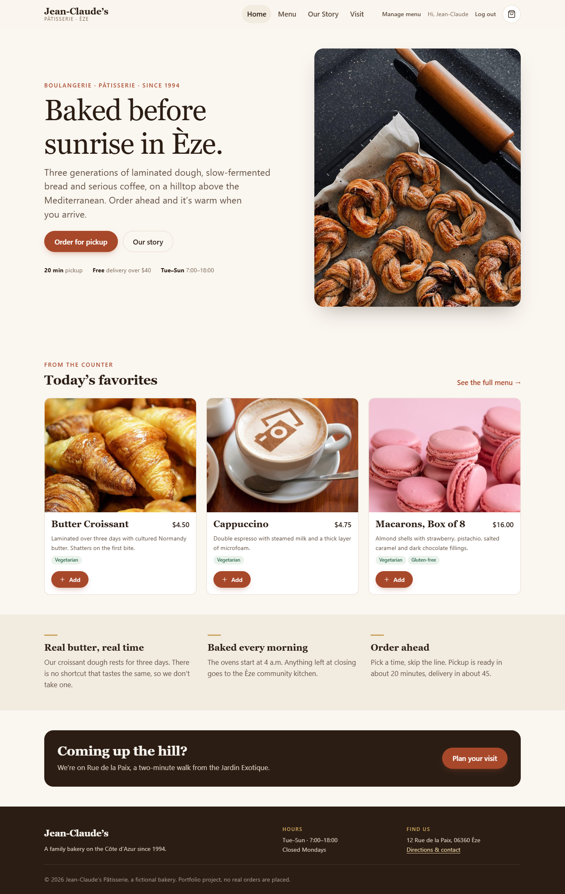

# Jean-Claude’s Pâtisserie

An online ordering site for a fictional family bakery in Èze, France. Customers browse the menu, build an order, and check out for pickup or delivery. A manager can add, re-price, feature and remove menu items.

Built with **vanilla HTML, CSS and JavaScript ES modules**: no framework, no bundler, no runtime dependencies. The interesting part is the architecture, not the tooling.



## Features

- **Menu** with section filters and accent-insensitive search. Filter state lives in the URL, so views can be bookmarked.
- **Cart drawer** on every page, built on `<dialog>`. It persists across reloads and stays in sync across open tabs.
- **Checkout** with pickup or delivery, percentage or custom tips, and pay-at-counter or card. A live summary updates as you type.
- **Validation** with inline, screen-reader-friendly errors: Luhn check on card numbers, expiry dates, phone and email.
- **Order confirmation** with a readable order number (`JC-7KQ2MX`) and an estimated ready time.
- **Accounts:** sign up and log in with salted PBKDF2 password hashing.
- **Manager dashboard:** add items, edit prices inline, toggle home-page features, delete, or restore the original menu.

## Running it

ES modules need to be served over HTTP (opening the file directly won’t work).

```bash
npm start        # serves on http://localhost:5501
# or: python -m http.server 5501
# or: VS Code "Live Server"
```

**Demo manager login:** `manager@jeanclaude.demo` / `croissant123` (there is also a one-click button on the login page).

**Test card:** `4242 4242 4242 4242`, any future expiry, any 3-digit code.

## Tests

```bash
npm test         # node --test, no install needed (Node 20+)
```

48 tests cover the cart state transitions, pricing math, validators, auth, the menu repository, order creation and seed-data integrity. CI runs them on every push (`.github/workflows/ci.yml`).

## Architecture

```
js/
├── data/menu.js           Seed menu: plain objects, prices in integer cents
├── lib/                   Framework-free utilities
│   ├── dom.js             h() element builder (text-only children → XSS-safe)
│   ├── money.js           Cents ↔ dollars, no floating-point drift
│   └── storage.js         Namespaced, fault-tolerant, injectable localStorage wrapper
├── services/              Business logic. No DOM access, unit-tested in Node
│   ├── cart.js            Pure state transitions + observable store
│   ├── pricing.js         Subtotal, delivery fee, tip, total
│   ├── validation.js      All form rules, returning { field: message }
│   ├── auth.js            Accounts, PBKDF2 hashing, sessions, safe redirects
│   ├── menu-repo.js       Read/write the menu (seed + manager edits)
│   └── orders.js          Place and look up orders
├── components/            Reusable UI: layout, cart drawer, menu card, toasts, forms
└── pages/                 One small entry module per HTML page
```

The layering is the main design decision. **Services never touch the DOM, and pages never do business logic.** That split is what makes the logic testable with Node’s built-in runner and no browser, and what lets checkout, confirmation and the cart drawer all agree on one implementation of the math.

### Decisions worth calling out

| Decision | Why |
| --- | --- |
| Prices stored as integer cents | `0.1 + 0.2 !== 0.3`. Money is never a float until it’s formatted for display. |
| Cart stores `{ id, quantity }` only | Prices are looked up from the menu at render and again at submit, so a stale cart can’t check out at an old price, and deleted items drop out cleanly. |
| No `innerHTML` with dynamic data | Every user-supplied string (admin item names, customer names) becomes a text node through `h()`, so an item named `` shows up as literal text. |
| Storage is dependency-injected | The services take a storage object, so tests run against an in-memory backend. Corrupted or unavailable storage degrades gracefully instead of crashing. |
| `<dialog>` for the cart | Native focus trapping, Esc-to-close and an inert background, instead of hand-rolled versions. |
| Native radio groups for segmented controls | They’re styled as buttons but keep arrow-key navigation and form semantics. |
| Post-login `?next=` is allow-listed | Only local `*.html` paths are accepted, so the login page can’t be used as an open redirect. |
| Card data is never stored | The order keeps only the last four digits. |

### Honest limitations

This is a static site with no backend, so everything “persisted” lives in the visitor’s browser:

- **Auth is a model of the flow, not security.** Passwords are salted and hashed with PBKDF2, but a determined user can edit `localStorage` and grant themselves the manager role. In production, accounts, roles and orders belong on a server, with HttpOnly session cookies.
- **Orders and manager edits are per-browser.** A manager’s changes are visible only on the device where they were made.
- **No real payments.** The card form validates format only. A real build would use a payment provider’s hosted fields so card data never touches our code.

Those are the next steps if this grew up: a small API (for example Node + SQLite) behind the same service interfaces. Because the pages only talk to services, swapping `localStorage` for `fetch` would not change the UI code.

## Accessibility

- Semantic landmarks, a skip link, and one `h1` per page
- Every input has a label; errors are linked with `aria-describedby` and announced, and focus moves to the first invalid field
- Toasts use a polite live region instead of blocking `alert()`
- Visible focus rings, `prefers-reduced-motion` respected, 44px touch targets on icon buttons
- Responsive from 320px up with no horizontal scrolling

## Project history

This started as the team final project for **CSET 120 (Fall 2023)**, built by Isaiah (IsaiahMar), Kishaun (Kishaun13) and Serena Asso-Gonzalez. The original is at [Kishaun13/Cset-120-project](https://github.com/Kishaun13/Cset-120-project).

Version 2 is a ground-up refactor of that project. It keeps the concept, the menu and the photography, and rebuilds the code:

| v1 (2023) | v2 |
| --- | --- |
| Menu was a 250-line HTML string in JS, edited with `contentEditable` | Menu is typed data, rendered by code and edited through a validated form |
| Nav and footer copy-pasted into 11 files, which had drifted | One layout module |
| Passwords stored in plain text, admin password hard-coded in client JS | Salted PBKDF2 hashes; demo manager documented openly |
| Prices parsed from DOM text (`"$4.00".substring(1)`) | Integer cents from the data model |
| Random 20–40 minute “ready in” time | Rule-based estimate per pickup or delivery |
| `alert()` for every message | Accessible toasts and inline errors |
| Bootstrap + jQuery + Font Awesome, 7 Google font families | No libraries, 2 font families, inline SVG icons |
| 6 MB of images, several hot-linked from other sites | 2.7 MB, all local, resized, with explicit dimensions |
| No tests | 48 unit tests + CI |

Photography is carried over from the original class project; the hero image is from Pexels.
